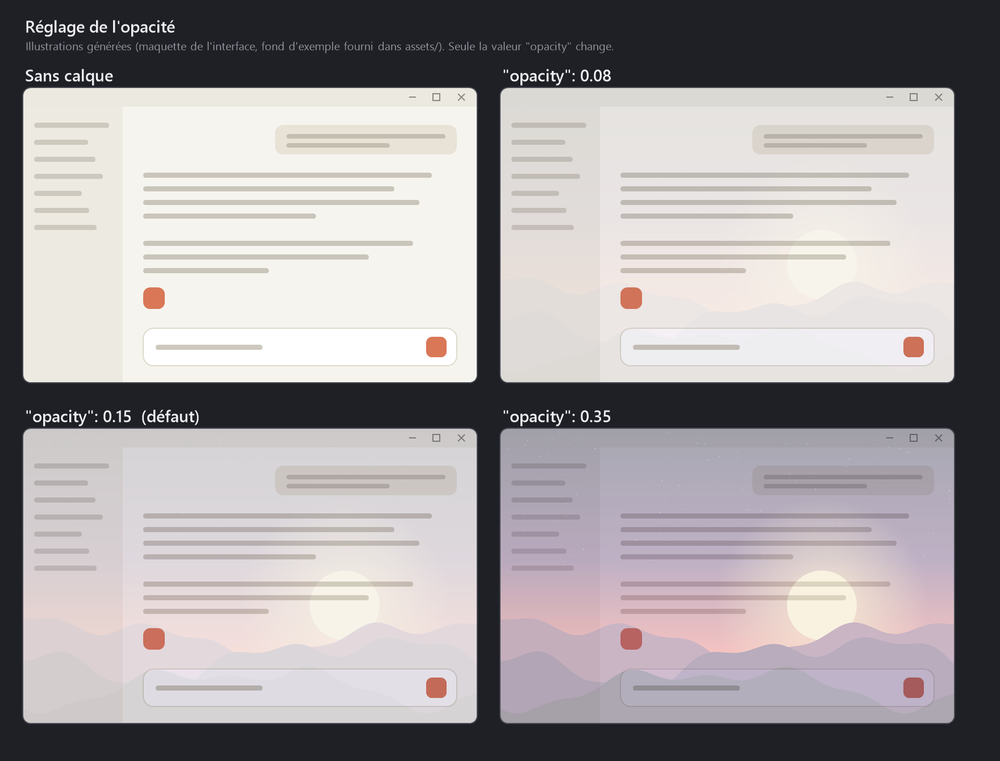
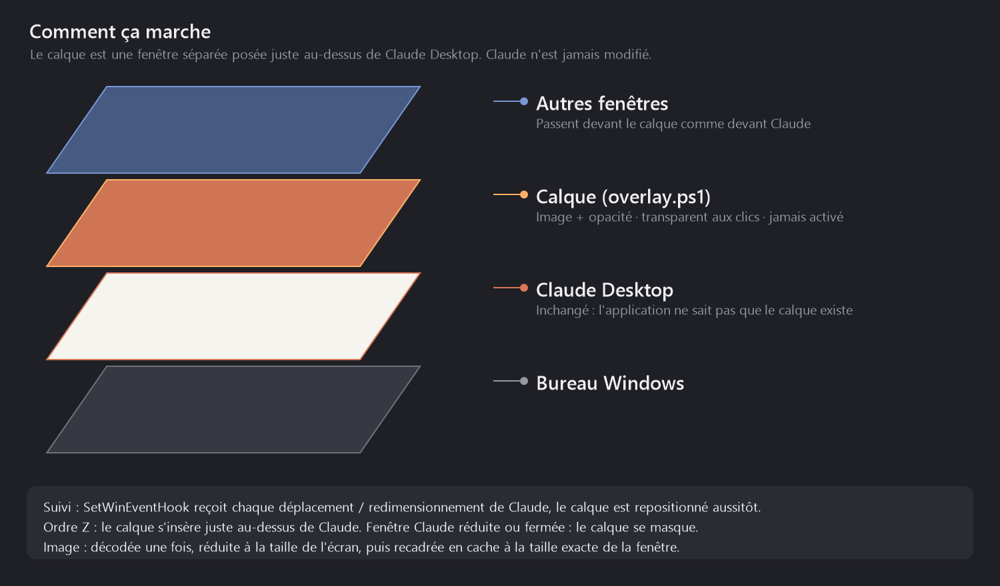

# Claude Desktop Custom Background

Show a background image, with the opacity of your choice, on **Claude Desktop**.


-1793D1)

> **Windows and Linux (Hyprland).** The Windows version relies on the Win32 API (windows, events, DWM) through PowerShell and .NET Framework, both shipped with Windows. The Linux version targets [Hyprland](https://hyprland.org), and therefore [Omarchy](https://omarchy.org): see [Linux (Hyprland / Omarchy)](#linux-hyprland--omarchy). There is no macOS version.



*Generated illustrations: a UI mockup with the sample image shipped in [`assets/`](assets/), not real screenshots. Only the `opacity` value changes from one panel to the next.*

## Table of contents

- [Why an overlay instead of CSS?](#why-an-overlay-instead-of-css)
- [Installation](#installation)
- [Configuration](#configuration)
- [Starting with Claude Desktop](#starting-with-claude-desktop)
- [How it works](#how-it-works)
- [Limitations](#limitations)
- [Troubleshooting](#troubleshooting)
- [Uninstall](#uninstall)
- [Linux (Hyprland / Omarchy)](#linux-hyprland--omarchy)
- [Repository contents](#repository-contents)

## Why an overlay instead of CSS?

Claude Desktop is an Electron app, so injecting CSS may sound like the obvious route. It is not an option:

- the app is installed as an MSIX package in `C:\Program Files\WindowsApps\`, a read-only folder that updates itself, so it cannot be patched cleanly;
- the app **deliberately refuses to start** with a debugging port (`--remote-debugging-port`): `Claude: refusing to start — a debugging or network-override switch is present on the command line.`

So this project does not work around anything and never touches Claude. It draws **a separate, click-through window** on top of the Claude window.

## Installation

The steps below are for Windows. On Linux, go to [Linux (Hyprland / Omarchy)](#linux-hyprland--omarchy).

### Requirements

- Windows 10 or 11
- Windows PowerShell 5.1 (already included in Windows, nothing to install)
- Claude Desktop

Tested on Windows 11.

### Steps

1. **Get the project**: `git clone https://github.com/zomboky/claude-desktop-custom-background.git`, or download the ZIP from GitHub and extract it. Keep the folder somewhere stable: the automatic startup depends on its location.

2. **Pick your image**: put it anywhere you like (JPG, PNG, BMP, GIF or TIFF; WebP is not supported by .NET Framework). To try it out first, the sample [`assets/sample-background.jpg`](assets/sample-background.jpg) is used by default.

3. **Run the installer** in PowerShell, from the project folder:

   ```powershell
   powershell -ExecutionPolicy Bypass -File .\install.ps1
   ```

   The script:
   - creates `config.json` from [`config.example.json`](config.example.json) if it does not exist;
   - creates a shortcut in your Startup folder (see [Starting with Claude Desktop](#starting-with-claude-desktop));
   - starts the overlay right away.

4. **Open Claude Desktop**: the image shows up. No administrator rights needed.

5. **Set your image**: edit `config.json` (see below). Changes are picked up within about a second, no restart needed.

For a one-off run, without installing the automatic startup:

```powershell
powershell -ExecutionPolicy Bypass -File .\overlay.ps1
```

(keep that PowerShell window open, or use `wscript.exe start-hidden.vbs` to run it without any window).

## Configuration

Everything is controlled by `config.json`, which is re-read live while the overlay runs. `config.json` is git-ignored, so your personal paths never get published.

```json
{
  "image": "C:/Users/you/Pictures/my-background.png",
  "opacity": 0.15,
  "fit": "cover"
}
```

| Key | Value | Purpose |
| --- | --- | --- |
| `image` | path | Image to display. Absolute, or relative to the folder containing `config.json`. |
| `opacity` | `0.01` to `0.99` (default `0.15`) | Opacity of the overlay. The higher it is, the more the image hides the interface. |
| `fit` | `"cover"` (default) or `"stretch"` | `cover` fills the window and crops without distortion; `stretch` stretches the image to the window size. |

> **Mind Windows paths in JSON.** Backslashes must be doubled (`C:\\Users\\you\\...`) or replaced by forward slashes (`C:/Users/you/...`). An invalid file is ignored: the previous image stays displayed.

The overlay is drawn **on top of** the interface (see [How it works](#how-it-works)), so keep the opacity low, between `0.05` and `0.2`, to keep text readable.

## Starting with Claude Desktop

`install.ps1` adds a `Claude overlay.lnk` shortcut to the Windows Startup folder (`shell:startup`). At every login:

1. `start-hidden.vbs` launches `overlay.ps1` with no visible window;
2. the overlay waits in the background, invisible, and shows nothing as long as Claude Desktop is not open;
3. as soon as a Claude window appears, the overlay covers it. When you minimize or close Claude, it hides;
4. an internal mutex prevents running two instances.

The net effect is that it behaves as if it started with Claude Desktop, without you having to think about it. Strictly speaking it starts with your session, not with Claude. The process stays running (about 140 MB of RAM); to stop it, right-click its notification-area icon and choose **Quit**.

To restart it manually:

```powershell
wscript.exe .\start-hidden.vbs
```

## How it works



Everything lives in [`overlay.ps1`](overlay.ps1): a small C# program compiled on the fly by PowerShell (`Add-Type`), with nothing to install.

- **A separate window.** The overlay is a borderless WinForms form using the extended styles `WS_EX_TRANSPARENT` (clicks go through), `WS_EX_NOACTIVATE` (it never takes focus) and `WS_EX_TOOLWINDOW` (no taskbar button, no Alt+Tab entry). The opacity is the window's own (`Form.Opacity`).
- **It finds Claude.** It enumerates top-level windows of class `Chrome_WidgetWin_1` owned by a `claude` process and keeps the largest one.
- **It follows Claude through events.** With `SetWinEventHook`, Windows notifies it on every move or resize of the window (`EVENT_OBJECT_LOCATIONCHANGE`), on foreground changes, on minimize/restore and on show/hide. There is no fast polling loop: a 250 ms timer is only a safety net (Claude opening, window order).
- **Exact dimensions.** It reads the visible frame with `DwmGetWindowAttribute(DWMWA_EXTENDED_FRAME_BOUNDS)`, which excludes the invisible margins of Windows 10/11, and declares itself per-monitor DPI v2 aware so it works in real pixels on scaled displays.
- **Z-order.** It sits **right above Claude** (`SetWindowPos` with the window that precedes Claude), rather than being "always on top": other windows stay in front, exactly as they would in front of Claude.
- **Fast image.** The image is decoded once, downscaled to the size of the largest screen and converted to `Format32bppPArgb` (the fastest format to draw). A copy cropped to the exact window size is cached: moving the window repaints nothing, resizing it only rebuilds that copy.
- **Rounded corners.** `DWMWA_WINDOW_CORNER_PREFERENCE` is set to rounded (Windows 11) to match the window.
- **Live config.** `config.json` is watched (modification time) and reloaded without a restart.

## Limitations

- **No macOS version.** Linux is supported on Hyprland only (see [Linux](#linux-hyprland--omarchy)).
- **The overlay is above the interface**, not behind it: Claude's backgrounds are opaque, so an overlay placed behind would be invisible. The image therefore sits on top of the text, hence the low opacity recommended.
- **Tracking is not perfectly synchronous**: a separate window follows Claude, so a slight lag is possible during very fast moves.
- The overlay follows **a single Claude window**: the largest visible one.
- This is not a Claude Desktop feature: a major app update that changes the type of its windows could require adapting the detection (`IsClaudeWindow` in `overlay.ps1`).
- Opacity is uniform over the whole image; there is no gradient.

## Troubleshooting

**The image does not show up.**
- Check that the overlay is running: `Get-CimInstance Win32_Process -Filter "Name='powershell.exe'" | Where-Object { $_.CommandLine -match 'overlay.ps1' }`.
- Check that `config.json` is valid JSON (paths with `/` or `\\`) and that the image exists.
- To see its messages, run `overlay.ps1` in a visible PowerShell window: `config: opacity=… image=…` confirms the load, while `config: …` followed by an error tells you the cause.

**The overlay does not start at login.** Check that `Claude overlay.lnk` is in `shell:startup` and that the project folder has not been moved: run `install.ps1` again from the new location.

## Uninstall

```powershell
powershell -ExecutionPolicy Bypass -File .\uninstall.ps1
```

The script stops the overlay and removes the startup shortcut. Since no Claude Desktop file was ever modified, there is nothing else to restore. You can then delete the project folder.

## Linux (Hyprland / Omarchy)

The same overlay, rewritten for Wayland: [`linux/overlay.py`](linux/overlay.py) (Python + GTK 3). It works on any **Hyprland** session, which is what [Omarchy](https://omarchy.org) runs. Other compositors (GNOME, KDE, Sway) are not supported: Wayland gives no standard way to find and follow another app's window, so the overlay relies on Hyprland's IPC.

### Requirements

- Hyprland (Omarchy, or any Arch / other distro running Hyprland)
- Claude Desktop for Linux (for example the `claude-desktop-bin` AUR package, or another community build)
- Python 3, PyGObject, GTK 3 and `gtk-layer-shell`. On Arch / Omarchy:

  ```bash
  sudo pacman -S --needed python-gobject python-cairo gtk3 gtk-layer-shell
  ```

### Steps

```bash
git clone https://github.com/zomboky/claude-desktop-custom-background.git ~/.local/share/claude-desktop-custom-background
cd ~/.local/share/claude-desktop-custom-background
./linux/install.sh
```

Keep the folder where it is: the service points to it. The installer:

- creates `config.json` from `config.example.json` if it does not exist (same file and same keys as on Windows, see [Configuration](#configuration));
- creates a systemd **user** service, `~/.config/systemd/user/claude-overlay.service`, bound to `graphical-session.target` (Omarchy starts Hyprland through `uwsm`, so this target exists and the overlay starts with every session);
- starts the overlay right away. No `sudo` needed.

If Hyprland is not started through `uwsm`, the installer says so and gives the `exec-once = ...` line to add to `hyprland.conf` instead.

For a one-off run, without the automatic startup: `./linux/overlay.py` (Ctrl+C to quit).

### Linux-only setting

On Linux, `config.json` accepts one more, optional key:

| Key | Value | Purpose |
| --- | --- | --- |
| `match` | regular expression | Window class (Wayland `app_id` or X11 class) that identifies Claude. Default: `(?i)^(claude\|claude-desktop\|com\.anthropic\.claude.*)$`, which covers the usual packages. |

Linux paths need no escaping in JSON (`"image": "/home/you/Pictures/bg.png"`), and `~` is expanded. WebP works if `webp-pixbuf-loader` is installed.

If the image never shows up, check which class your Claude build uses:

```bash
./linux/overlay.py --list-windows
```

Claude must be open. Lines marked `*` are recognized; if Claude is not among them, put its class in `match`.

### How it works on Linux

- **A layer-shell surface.** Under Wayland an app cannot place its own window, so the overlay is a [`wlr-layer-shell`](https://wayland.app/protocols/wlr-layer-shell-unstable-v1) surface (namespace `claude-overlay`) on the `top` layer, anchored to the top-left corner of the screen; its margins and size are set to the exact rectangle of the Claude window. Its input region is empty, so every click goes through to Claude, and it never takes keyboard focus.
- **It finds Claude** through Hyprland's IPC socket (`hyprctl clients`): the largest mapped window whose class matches `match`, on the workspace currently shown on its monitor. If another window is fullscreen or maximized on that workspace, or Claude is on a hidden workspace, the overlay draws nothing.
- **It follows Claude through events.** It listens to Hyprland's event socket (`socket2`: window opened, closed or moved, workspace change, fullscreen, floating...) and repositions immediately. A 250 ms timer is only a safety net, mainly for mouse resizes of a floating Claude window, which emit no event.
- **Floating windows stay readable.** Wayland gives no stacking order, so the overlay cuts out (draws nothing over) the floating windows that sit on top of Claude: all floating windows on its workspace when Claude is tiled, and those focused more recently than Claude when Claude is floating.
- **Fullscreen.** When Claude itself goes fullscreen the overlay moves to the `overlay` layer, since fullscreen windows cover the `top` layer.
- **Rounded corners and borders** follow Hyprland's `decoration:rounding` and `general:border_size`, read at startup and every second.
- **Fast image.** As on Windows, the image is decoded once, downscaled to the largest screen, and a copy fitted to the window size is cached; moving the window repaints nothing.
- **Live config.** `config.json` is checked every second and reloaded without a restart.

### Linux limitations

- **Hyprland only**, for the reasons above.
- **The overlay sits above the interface**, as on Windows: keep the opacity low.
- **Claude's own menus and dialogs** (popups) are drawn under the overlay, which therefore tints them slightly.
- **Tracking lag:** Hyprland animates windows to their new position while the overlay jumps there directly; resizing a floating Claude window with the mouse is followed every 250 ms.
- **One Claude window**: the largest visible one.

### Linux troubleshooting

- Is it running? `systemctl --user status claude-overlay`
- Its messages: `journalctl --user -u claude-overlay -f`. `config: opacity=… image=…` confirms the load, `config: …` followed by an error gives the cause.
- `dépendances manquantes` in the log: install the packages listed in [Requirements](#requirements-1).
- Nothing shows up while Claude is open: run `./linux/overlay.py --list-windows` (see above).

### Linux uninstall

```bash
./linux/uninstall.sh
```

Stops the overlay and removes the systemd user service. Nothing else was modified; you can then delete the project folder.

## Repository contents

| File | Purpose |
| --- | --- |
| `overlay.ps1` | The overlay (PowerShell + inline C#), Windows. |
| `start-hidden.vbs` | Runs `overlay.ps1` without a window. |
| `install.ps1` / `uninstall.ps1` | Add / remove the automatic startup on Windows. |
| `linux/overlay.py` | The overlay for Linux (Hyprland / Omarchy), Python + GTK 3 + gtk-layer-shell. |
| `linux/install.sh` / `linux/uninstall.sh` | Add / remove the systemd user service on Linux. |
| `config.example.json` | Configuration template (shared by both versions). |
| `assets/sample-background.jpg` | Sample image generated for this project. |
| `docs/` | README illustrations. |
